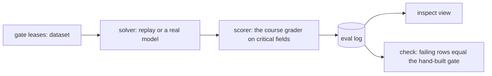

# Score the answers with Inspect AI

## The problem

You built the dataset, the model call and the grader of your release gate by hand. That is how you learn what each piece does. Teams in production rarely keep that code. They use an open-source eval runner, so the pieces have shared names and a log viewer for free.

For example, run the cheaper model through Inspect AI. It scores 50 gate leases, three trials each. It fails the same leases that your hand-built gate blocks.

## Why it matters

A runner you did not write is a runner a new teammate may already know. Inspect AI splits an eval into three parts: a dataset, a solver and a scorer. The source is the [Inspect AI documentation](https://inspect.aisi.org.uk/), from the UK AI Security Institute. Your hand-built pieces map one to one onto those three, so the port is small. The check proves it: the rows Inspect fails must be the rows your gate fails.

## What we teach

- A dataset is a list of samples. A solver gets a sample and produces an answer. A scorer grades the answer.
- A log is the saved record of one run. It holds a score per sample and the version of the tool.
- An epoch is one more run of every sample. Three epochs and a reducer called `at_least_2` match the gate rule "right in 2 of 3 trials".



## Steps

| Step                    | Minutes | You produce                                                                             | The check reads                                                                    |
| ----------------------- | ------- | --------------------------------------------------------------------------------------- | ---------------------------------------------------------------------------------- |
| `port-the-gate`         | 30      | `assignment/task.py`: your gate as an Inspect AI task                                   | the Inspect AI version, the eval log, and the failing rows                         |
| `score-your-own-traces` | 25      | `my_traces.jsonl`, `judge.txt`, `my_task.py` and `my_scores.jsonl` from your own system | the traces are yours, the judge names one criterion, and every trace has a verdict |

This part is optional in the live session and expected as homework. The `assignment/` folder holds the starter and its own README. The capstone is in `capstone/`: the same pieces, run on your own folder.

## Options

Inspect AI is the pick for a Python team. Promptfoo is the runner-up.

- **Choose when:** the team works in YAML and TypeScript, or wants red-team presets.
- **Trade-off:** a Python scorer is less natural there.

## Walkthrough

From the repo root, run the reference solution on the cheaper model. It replays saved answers, so you need no key:

```bash
uv run inspect eval parts/07-score-the-answers-with-inspect-ai/01-port-the-gate/solution/task.py --model mockllm/model --log-dir world/logs/inspect
```

Expect: a score table with `monthly_rent` mean `0.720`, `rent_steps` `0.860`, `deposit` `0.960` and `renewal_notice_days` `0.860`.

```bash
uv run inspect view --log-dir world/logs/inspect
```

Expect: a local web page that shows each sample and its transcript. Press Ctrl+C to stop it.

To use a real model, set your key as the course describes in the README, then add `-T replayed=false` and `--model anthropic/<your model id>`:

```bash
uv run inspect eval assignment/task.py -T replayed=false --model anthropic/<your model id> --log-dir assignment/logs
```

Expect: the same table, scored from live answers. It needs a key and costs a few cents.

```bash
bun run verify port-the-gate solution
```

Expect: `Done. All 3 rules pass.`

```bash
uv run checks/assignment.py
```

Expect: `FAIL` lines on the untouched starter, and `PASS` on all three lines once your task is ported.

```bash
bun run verify score-your-own-traces
```

Expect: `Done. All 7 rules pass.`, once your own traces, judge and scores are in the folder.

```bash
bun capstone/check.ts my-eval
```

Expect: `Done. All 9 rules pass.`, once your own folder is filled in. See `capstone/README.md`.

## What you can show

An Inspect AI task that fails the same leases as your hand-built gate, and a `CHOICE.md` that says when promptfoo fits better.
